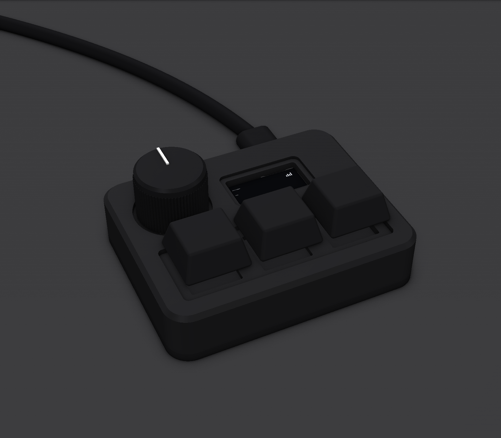
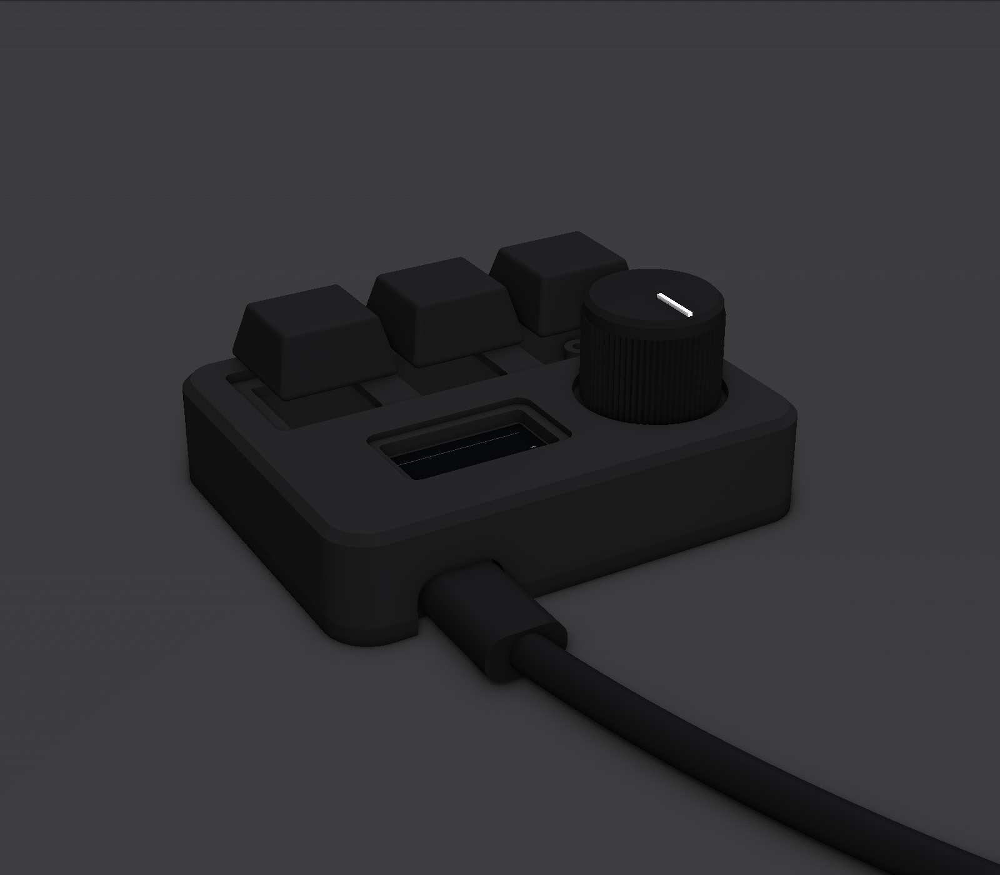
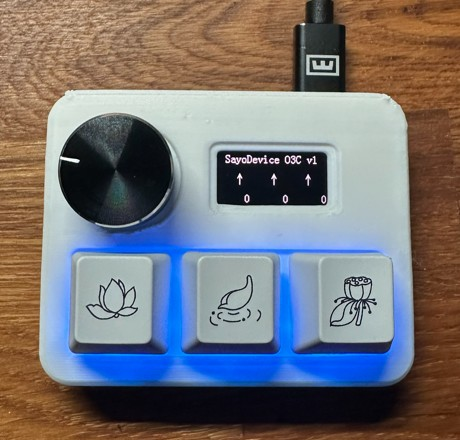
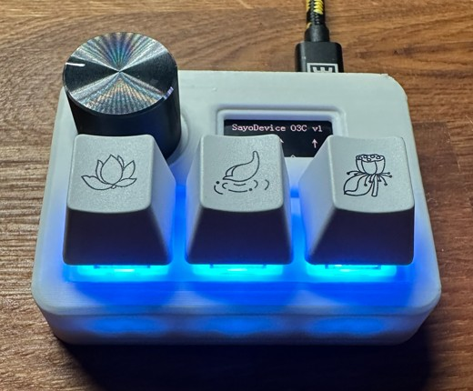

# SayoDevice O3C Case

[](https://github.com/lucasovbetts-tech/SayoDevice-OC3-case-model/actions/workflows/ci.yml)

A parametric matte black aluminium enclosure for the SayoDevice O3C macropad, built in Python with [CadQuery](https://cadquery.readthedocs.io/).





## Download

**You don't need to run any code.** The ready-made files are in the [`download`](download) folder. Click a file, then click the download button (↓) at the top right.

| File | What it's for |
|---|---|
| [`o3c_case_top.stl`](download/o3c_case_top.stl), [`o3c_case_bottom.stl`](download/o3c_case_bottom.stl) | Upload these to a 3D printing service (or your own printer) |
| [`o3c_case_top.step`](download/o3c_case_top.step), [`o3c_case_bottom.step`](download/o3c_case_bottom.step) | Upload these to a CNC machining service for the aluminium version |

You'll also need **4 × M2 × 14 countersunk screws**. See [Ordering notes](#ordering-notes) for what to tell the CNC shop.

Only run the script yourself if you want to change the design.

## Design

The case replaces the O3C's original plates. Only the keycaps, knob, screen and USB-C port are visible from outside.

| Kept from the O3C | Replaced by the case |
|---|---|
| PCB | Black metal top plate → roof of the top shell |
| Top acrylic frame (holds the screen) | Bottom acrylic + bottom metal plate → base |
| Switches, keycaps, knob | |

- **Top shell:** 3 mm roof with walls that hide the PCB and acrylic. The roof is thinned to 1.4 mm (the same as the original plate) in one long recess under the keycaps and a round recess under the knob, so the switches clip in like they did originally.
- **Base:** 2.6 mm floor with 4 posts (3.8 mm, the same height as the old bottom acrylic) that the PCB sits on.
- **Screws:** 4 hidden M2 screws come up from underneath through the base, posts, PCB and acrylic into tapped holes in the roof, clamping everything together.
- **Size:** 71.6 × 56.6 × 15.6 mm (without keycaps and knob).

All key dimensions were measured off a real O3C (±0.1 mm). The parameters at the top of `sayodevice_case.py` say which ones are measured and which are design choices you can change freely (wall thickness, roof thickness, clearances, chamfer).

## Test print

The first 3D-printed test fit (white ABS). Everything lined up: the screen window, knob recess, key recess and USB-C slot all fit the real O3C. The only change afterwards was making the top shell 1 mm taller (`STACK_EXTRA`) so it sits flush on the base.

| | |
|---|---|
|  |  |

The blue glow is the key LEDs shining through the white plastic. Black anodised aluminium won't let light through.

## Changing the design

Edit the parameters at the top of `sayodevice_case.py`, then rebuild the files. Install the dependencies (first time only):

```
py -m pip install -r requirements.txt
```

Run the script:

```
py sayodevice_case.py
```

Files are written to `~/Downloads/o3c_case`. Options:

| Option | What it does |
|---|---|
| `--out FOLDER` | Write the files somewhere else, e.g. `py sayodevice_case.py --out build` |
| `--no-render` | Skip the preview renders (much faster if you only need the STEP/STL files) |
| `--download` | Only rebuild the 4 files in this repo's `download` folder, then stop |

On macOS/Linux, use `python` instead of `py`.

If you change the design for everyone, run `py sayodevice_case.py --download` and commit the updated files. CI fails if you forget (see [Testing](#testing)).

## Testing

The tests check that both parts build as valid solids with the expected outer dimensions (to 0.01 mm), and that the files in `download/` match what the script builds now, so the downloadable files can't fall out of date. Run them after changing the parameters:

```
py -m pytest
```

They also run automatically on GitHub for every push and pull request (the CI badge at the top), along with a full build of the files.

## Output files

| File | Use |
|---|---|
| `o3c_case_top.step`, `o3c_case_bottom.step` | Send to a CNC shop for an aluminium quote |
| `top.stl`, `bottom.stl` | 3D print these for a test fit before ordering metal |
| `keycaps`, `knob`, `knob_line`, `plug`, `cable`, `desk` `.stl` | Props for the render only |
| `o3c_case_render.png`, `o3c_case_render_back.png` | Preview renders |
| `screen.png` | Screen texture used in the render |

## Test print first

Print `o3c_case_top.stl` and `o3c_case_bottom.stl` and fit your O3C before ordering aluminium. Reprinting plastic is much cheaper than remaking metal.

- **Top shell:** print it upside down (top face on the bed). Only the USB slot needs a little support.
- **Base:** print it flat side down, posts up. No supports needed.
- **Switch holes:** printed holes often come out 0.1-0.2 mm small. File them rather than changing the design.
- **Screws:** M2 screws cut their own thread in plastic. Tighten gently, especially the front two (only 1.4 mm of material).

Check that:
1. The PCB and acrylic drop in and the screw holes line up
2. The USB-C cable plugs all the way in
3. The switches clip in and the keycaps don't rub when pressed
4. The knob turns without scraping its recess

## Ordering notes

### Top shell (CNC machined)

Send `o3c_case_top.step`.

- **Tapped holes:** STEP files don't carry thread information, so add a note to the order: **4× M2 tapped holes from the underside**. The back two are blind (1.6 mm pilot, 2 mm deep). The front two go through into the key recess floor (1.4 mm thick).
- **Switch holes:** the 3 switch holes must be **14.0 mm square** with an inside corner radius of **0.5 mm or less**, otherwise the switches won't seat. The roof under the keys must stay **1.4 mm** thick so the switch clips catch.
- **Material:** 6061 aluminium is the standard, cheapest choice.
- **Finish:** bead blast + **black anodise** for the matte black look.
- **Tolerances:** standard tolerances are fine everywhere else.

### Base (CNC machined)

Send `o3c_case_bottom.step`.

- The posts and countersunk screw holes are already in the model.
- **Material:** 6061 aluminium.
- **Finish:** bead blast + black anodise to match the top, plus deburring.

### Hardware

| Qty | Part | Use |
|---|---|---|
| 4 | M2 × 14 countersunk screw | Base → top shell (from below, through the PCB stack) |
| 4 | Rubber feet (optional) | Grip on the desk. Keep them clear of the screw heads if you want to open the case again |

## Assembly

1. Take the O3C apart: remove the knob, the keycaps and the 4 corner screws, then lift off the top plate (switches come with it) and the bottom plates.
2. Pull the switches out of the old top plate.
3. Put the PCB on the base posts and the top acrylic frame (with the screen) on the PCB.
4. Lower the top shell over the stack and screw it together from underneath.
5. Clip the switches in through the roof into the hot-swap sockets, then fit the keycaps and knob.
